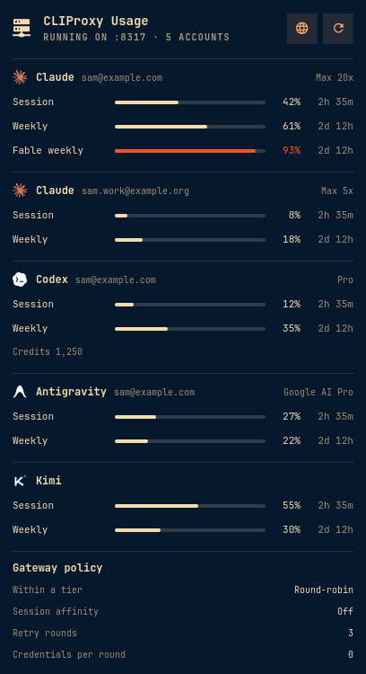

# CLIProxy Usage for Omarchy

A bar widget for [Omarchy](https://omarchy.org) that shows how much of each plan is left for every account behind
your local [CLIProxyAPI](https://github.com/router-for-me/CLIProxyAPI). It covers session, weekly and per-model limits,
with the time until each one resets, and also shows whether the proxy is answering.



*The screenshot uses made-up accounts.*

It finds everything you've signed in to CLIProxyAPI, so there's nothing to configure. Each account that returns usage
numbers gets its own section, and the rest are listed in one line at the bottom along with the reason.

| Sign-in type in CLIProxyAPI | What's shown |
|---|---|
| Claude (`claude`) | 5-hour session, weekly, model-scoped weekly (e.g. Fable), plan, extra usage |
| Codex (`codex`) | 5-hour session, weekly, model-specific limits, plan, credits |
| Antigravity (`antigravity`) | Gemini session and weekly, Claude/GPT allowances once used, plan |
| Kimi (`kimi`, `kimi-ai`) | session, weekly and monthly limits |
| Grok (`xai`) | weekly credits and monthly quota |
| Devin (`devin`) | daily and weekly quota, plan |
| Meta (`meta`) | session and weekly, plan |

Vertex service accounts, Gemini API keys, and any key-based upstream configured in `config.yaml` bill per use and have
no plan limits, so they don't appear.

## Requirements

- Omarchy 4 with the Omarchy shell.
- CLIProxyAPI running on this machine, with at least one OAuth sign-in from the table above.
- `python3`, which Omarchy already includes. The collector only uses the standard library.

## Install

```sh
omarchy plugin add https://github.com/chillerno1/omarchy-cliproxy-usage --enable
```

The icon (󰒍) appears on the right of the bar. You can move it with
`omarchy bar move chillerno1.cliproxy-usage --section right --index 0`.

## Use

- **Click** opens the panel.
- **Middle-click**, or `R` in the panel, checks every account now.
- **Right-click**, or `O` in the panel, opens CLIProxyAPI's own control panel.
- The icon turns to the urgent color when a session or weekly limit passes 90%, or when the proxy stops answering.

Percentages show quota **used**. CLIProxyAPI's Antigravity panel shows quota **remaining**, so 93% there means 7% used here.

Hover a meter to see the exact percentage. The bar can also drive it from the shell:

```sh
omarchy-shell chillerno1.cliproxy-usage toggle
omarchy-shell chillerno1.cliproxy-usage refresh
```

Setting: `refreshIntervalSec` (default 600, minimum 60), under Setup › Plugins or in `~/.config/omarchy/shell.json`.
An answer less than two minutes old is reused, so opening and closing the panel doesn't hit the providers again.

## How it works and what it touches

`bin/collector.py` runs on a timer and whenever the panel opens. It prints one JSON record that `Panel.qml` draws.

- **Where it finds the proxy.** It reads the `--config` path of the running `cli-proxy-api` process, and falls back to
  `~/.cli-proxy-api/config.yaml`. You can override this with the `CLIPROXY_CONFIG` environment variable. From that file
  it reads only `port` and `auth-dir`.
- **What it reads.** The OAuth credential files in `auth-dir`, read-only. It never refreshes or rewrites a token; that
  stays CLIProxyAPI's job. If an access token has lapsed, the collector skips that account until the proxy refreshes it
  on its next request.
- **What it sends.** Each token goes only to the provider that issued it, over HTTPS, at these fixed endpoints:
  - `api.anthropic.com` `/api/oauth/usage` and `/api/oauth/profile`
  - `chatgpt.com` `/backend-api/wham/usage`
  - `daily-cloudcode-pa.googleapis.com`, with `daily-cloudcode-pa.sandbox.googleapis.com` and
    `cloudcode-pa.googleapis.com` as fallbacks: `loadCodeAssist` and
    `retrieveUserQuotaSummary`
  - `api.kimi.com` or `api.kimi.ai` `/coding/v1/usages`
  - `cli-chat-proxy.grok.com` `/v1/billing`
  - `server.codeium.com` `GetUserStatus`
  - `api.meta.ai` `/muse-code/key`

  It also checks `http://127.0.0.1:<port>/` to see whether the proxy is answering. Nothing goes anywhere else.
- **What it writes.** One file, `~/.cache/chillerno1.cliproxy-usage/usage.json`, mode `600` in a `700` folder. It holds
  the last good numbers per account and no tokens.
- **Limits on what it trusts.** Answers are capped at 1 MB and requests time out after 10 s. Text from providers is
  trimmed to one bounded line and always drawn as plain text.

This plugin isn't affiliated with CLIProxyAPI or any of the providers. The usage endpoints aren't public APIs and can
change without notice. When one does, that account shows its last known numbers, marked stale, until the plugin is
updated.

## Remove

```sh
omarchy plugin remove chillerno1.cliproxy-usage
rm -rf ~/.cache/chillerno1.cliproxy-usage
```

## Develop

```sh
python3 -m unittest discover -s tests      # parsers for every provider, caching, plain-text rule
python3 -I bin/collector.py --force        # the record the panel draws, from your real accounts
omarchy plugin validate .
```

Saving any file under `~/.config/omarchy/plugins/chillerno1.cliproxy-usage/` reloads the plugin.

## License

MIT, see [LICENSE](LICENSE). The provider icons in `assets/` come from Omarchy's Agents plugin (MIT, © Omarchy
contributors), and the marks belong to their owners.
